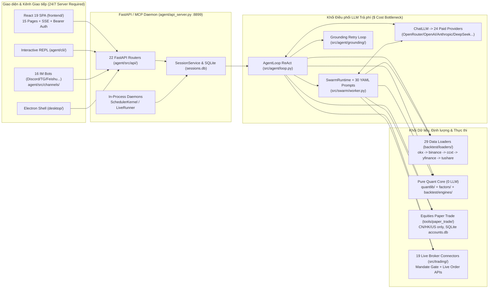

# BÁO CÁO KIỂM TOÁN PHẪU THUẬT MÃ NGUỒN — PHASE P0 (`P0_AUDIT_REPORT.md`)
## Dự án: VibeTrade v1.1 (*Personal Autonomous Crypto Intelligence System — $0 Budget Edition*)

- **Repository gốc được kiểm toán:** `HKUDS/Vibe-Trading` (`v0.1.18`, commit `78fab6b3f998583f640820db60c155ffa5641a62`, tổng cộng `3,164` files).
- **Chế độ thực thi:** **100% Read-Only** đối với toàn bộ mã nguồn gốc (`git diff` = rỗng tuyệt đối; `0` file gốc bị chỉnh sửa hay xóa).
- **Skill áp dụng:** `codebase-surgical-auditor` (tuân thủ nguyên tắc **No Full Rewrite**, phân loại 4 nhãn `KEEP` / `ADAPT` / `REPLACE` / `REMOVE` kèm trích dẫn chính xác đường dẫn file và tên class/hàm).

---

## 1. Tổng Quan Kiến Trúc Hiện Tại Của `Vibe-Trading` & Sơ Đồ Luồng Dữ Liệu

### 1.1 Bản Chất Kiến Trúc Hiện Tại
`HKUDS/Vibe-Trading` hiện tại là một **nền tảng Trợ lý Nghiên cứu Tài chính Đa tài sản điều khiển bằng Ngôn ngữ Tự nhiên (Stateful, LLM-Centric, Multi-Asset Workstation)** xoay quanh một tiến trình máy chủ chạy nền 24/7 (`agent/api_server.py` trên cổng `:8899` hoặc CLI tương tác `agent/cli/main.py`).

Toàn bộ kho mã nguồn chia thành **2 nửa rất rõ rệt**:
1. **Lớp Vỏ Đắt Đỏ & Nặng Nề (Cần `REMOVE` hoặc `REPLACE`):**
   - Bộ điều phối hội thoại LLM trả phí (`ChatLLM`, `AgentLoop`, `SwarmRuntime` với 24 nhà cung cấp LLM thương mại).
   - Máy chủ FastAPI/SSE/MCP chạy 24/7 (`agent/api_server.py`, `agent/mcp_server.py`, `agent/src/api/`), 16 kênh chat bot (`agent/src/channels/`), vỏ Electron Desktop (`desktop/`), ZimaOS NAS (`zimaos/`), và 19 cổng kết nối đặt lệnh thật tới các sàn chứng khoán/crypto (`agent/src/trading/connectors/`).
   - 26 bộ nạp dữ liệu cổ phiếu/trái phiếu/phái sinh/API trả phí (`tushare`, `finnhub`, `qveris`, `gildata`, `yfinance`, `akshare`, `binance`, v.v.).
2. **Phần Lõi Định Lượng Tinh Khiết — "Mỏ Vàng" Không Phụ Thuộc LLM (Cần `KEEP` và `ADAPT`):**
   - Thư viện toán định lượng chuẩn tổ chức (`agent/src/quantlib/`: microstructure, slippage impact, VaR/CVaR, GARCH/Markov regime, purged walk-forward, deflated Sharpe).
   - Hệ toán tử nhân quả không rò rỉ tương lai (`agent/src/factors/base.py`) và lõi mô phỏng khớp lệnh `Open[t+1]` (`agent/backtest/engines/base.py`, `crypto.py`, `regime.py`, `metrics.py`).
   - Lõi phân tích độ sâu sổ lệnh L2 (`agent/src/tools/orderbook_depth_tool.py`), chỉ báo kỹ thuật (`technical_indicator_tool.py`), kiểm toán số học (`report_audit_tool.py`, `financial_rigor_tool.py`).
   - Kiến trúc hợp đồng rủi ro bất biến `@dataclass(frozen=True)` (`agent/src/live/mandate/model.py`, `store.py`), ghi file nguyên tử `.tmp` + `os.fsync` + `os.replace` (`pending_action.py`, `core/state.py`), sổ cái băm SHA-256 (`governance/ledger.py`), và bộ biểu đồ ECharts + tính toán Tearsheet thuần client trên React 19 (`frontend/src/lib/tearsheet.ts`, `frontend/src/components/charts/`).

### 1.2 Sơ Đồ Luồng Dữ Liệu Hiện Tại Của `HKUDS/Vibe-Trading`



---

## 2. Kiểm Toán Chi Tiết 5 Khía Cạnh Trọng Tâm

### 2.1 Khía Cạnh 1: Phụ Thuộc LLM API Trả Phí & Nguồn Dữ Liệu Thị Trường Cũ

#### A. Truy vết toàn bộ điểm phụ thuộc LLM trả phí
1. **Gói thư viện (`pyproject.toml`, `agent/requirements.txt`):**
   - Ghim cứng `langchain>=1.3.9,<2`, `langchain-core>=1.0.0,<2`, `langchain-openai>=1.0.0,<2`, `langgraph>=1.2.14,<1.3`, `langgraph-checkpoint>=2.1.0,<5`, `langgraph-sdk>=0.4.6`, và tùy chọn `langchain-anthropic`, `langchain-deepseek`, `github-copilot-sdk`.
   - **Phát hiện quan trọng:** Dù khai báo `langgraph` trong `pyproject.toml`, toàn bộ thư mục `agent/` có **0 lệnh import `langgraph`**. Luồng tác tử thực chất chạy bằng vòng lặp Python tự viết `AgentLoop.run()` trong `agent/src/agent/loop.py` và `_run_worker_impl()` trong `agent/src/swarm/worker.py` gọi trực tiếp `ChatLLM` (`agent/src/providers/chat.py`). Nhờ đó việc cắt bỏ LLM rất gọn, không bị vướng đồ thị trạng thái phức tạp của LangGraph.
2. **Nhà máy khởi tạo 24 nhà cung cấp LLM (`agent/src/providers/`):**
   - `agent/src/providers/llm_providers.json`, `capabilities.py` (`get_llm_credentials()`), và `llm.py` (`build_llm()`, `_build_anthropic()`, `_build_native_deepseek()`) kết nối tới 24 dịch vụ trả phí/đám mây (`openrouter` mặc định gọi `anthropic/claude-sonnet-4.6`, `openai`, `anthropic`, `deepseek`, `copilot_auth.py:CopilotSDKLLM`, `openai_codex.py:OpenAICodexLLM`, `claude_cli.py:ClaudeCliLLM`, v.v.).
   - Ngoài ra, `agent/src/tools/ocr/llm_vision_ocr.py` (`LlmVisionOcrEngine`) import trực tiếp `from openai import OpenAI` để gọi Vision OCR trả phí.
3. **Vòng lặp hội thoại, nén ngữ cảnh và kiểm chứng văn bản LLM (`agent/src/agent/`):**
   - `loop.py` (`AgentLoop`), `context_compact.py` (`_microcompact()`, `_context_collapse()` dùng LLM tóm tắt hội thoại), `llm_usage.py` (`_record_llm_usage()`), và `grounding/` (`GroundingLedger` trong `ledger.py`, `validate_and_release()` trong `loop_grounding.py`) tiêu tốn nhiều lượt gọi LLM liên tiếp để sửa văn bản tự do khi số liệu bị lệch.
4. **Đội ngũ Swarm Personas hiện tại (`agent/src/swarm/`):**
   - **Phần dính chặt LLM (`REPLACE`):** 30 file YAML trong `agent/src/swarm/presets/*.yaml` (như `crypto_research_lab.yaml`, `crypto_trading_desk.yaml`, `investment_committee.yaml`) định nghĩa nhân vật bằng `system_prompt` tự do. `SwarmRuntime` (`runtime.py`) đẩy từng task vào `run_worker()` (`worker.py`), khởi tạo `ChatLLM()` chạy tối đa `50` vòng gọi công cụ mỗi nhân vật. Nghiêm trọng hơn, `crypto_trading_desk.yaml` cho phép nhân vật LLM `risk_controller` tự sinh thông số rủi ro bằng văn bản — trái ngược hoàn toàn với quy tắc bất khả xâm phạm của VibeTrade v1.1.
   - **Phần độc lập hoàn toàn với LLM (`ADAPT`):** `agent/src/swarm/task_store.py` (`TaskStore`, `validate_dag()`, `topological_layers()`, `resolve_dependencies()`) và `agent/src/swarm/store.py` (`SwarmStore`, `_replace_with_retry()`) không hề import LLM, cung cấp sẵn bộ lập lịch đồ thị có hướng (DAG) để thực thi tuần tự/song song `Analysts -> Bull / Bear -> Crucible -> Verifier -> Risk Controller`.

#### B. Truy vết nguồn dữ liệu cũ & Giải phẫu sâu 3 bề mặt OKX hiện có
1. **Sự nguy hiểm của chuỗi Fallback ngầm (`agent/backtest/loaders/registry.py` & `agent/src/market_data.py`):**
   - `VALID_SOURCES` trong `registry.py` đăng ký tới **29 nguồn dữ liệu** (cổ phiếu Trung Quốc `tushare`, `akshare`, `baostock`, `eastmoney`, `mootdx`; Mỹ/quốc tế `yfinance`, `yahoo`, `stooq`, `finnhub`, `alphavantage`, `tiingo`, `fmp`, `gildata`, `qveris` tốn phí; Brazil `b3_cotahist`; Hàn Quốc `pykrx`; Ấn Độ `india_broker`; Iran `nobitex`/`wallex`; và crypto `okx`, `binance`, `ccxt`).
   - Đặc biệt, `FALLBACK_CHAINS["crypto"] = ["okx", "binance", "ccxt", "yfinance", "local"]` (`registry.py`) kết hợp `get_loader_cls_with_fallback()` sẽ **âm thầm chuyển sang gọi Binance hoặc Yahoo Finance** nếu OKX chập chờn — làm sai lệch giá/khối lượng/bước giá của sàn OKX và vi phạm quy tắc nguồn dữ liệu duy nhất!
2. **Giải phẫu Bề mặt OKX #1 — `agent/backtest/loaders/okx.py` (`DataLoader`):**
   - *Ưu điểm sẵn có:* Gọi trực tiếp OKX Public REST v5 không cần API key (`requires_auth = False`) qua `/api/v5/market/candles` và `/api/v5/market/history-candles`, có sẵn `retry_with_budget()` và `validate_ohlc()`.
   - **4 Lỗi Nghiêm Trọng bắt buộc phải phẫu thuật ở Phase P1 (`quant-data-guard`):**
     1. **Lỗi Rò rỉ Nến Chưa Đóng (Repainting / Lookahead Bug) tại dòng 329–330 của `agent/backtest/loaders/okx.py`:**
        ```python
        confirmed = [r for r in raw_rows if len(r) > 8 and str(r[8]) == "1"]
        rows = confirmed if confirmed else list(raw_rows)
        ```
        Khi trang dữ liệu trả về chỉ có cây nến đang chạy (`confirm == "0"`), danh sách `confirmed` rỗng và code **lập tức lấy nguyên `list(raw_rows)` chứa nến chưa đóng** đưa vào tính toán!
     2. **Thiếu kiểm tra kép `candle_close_time <= current_utc_ms`:** Chưa tính `candle_close_time = int(ts) + bar_duration_ms` để đối chiếu với thời gian thực UTC.
     3. **Đánh rơi cột thanh khoản USDT (`volCcyQuote`):** Dù đọc đủ 9 cột của OKX, hàm trả về cuối file chỉ giữ `["open", "high", "low", "close", "volume"]`, vứt bỏ `volCcyQuote` (khối lượng tính bằng USDT cực kỳ quan trọng để lọc thanh khoản Scanner P2) và `candle_close_time`.
     4. **Thiếu 3 nhóm endpoint Public Spot thiết yếu:** Chưa có hàm lấy danh mục & quy tắc bước lệnh `/api/v5/public/instruments?instType=SPOT` (`tickSz`, `lotSz`, `minSz`), quét nhanh `/api/v5/market/tickers?instType=SPOT`, và sổ lệnh trực tiếp `/api/v5/market/books` (hiện `orderbook_depth_tool.py` đang phải đi vòng qua thư viện `ccxt`).
3. **Giải phẫu Bề mặt OKX #2 — `agent/src/trading/connectors/okx/` (`sdk.py`, `profiles.py`):**
   - Dùng gói ngoài `python-okx`, ép buộc phải có đủ `OKX_API_KEY`, `OKX_API_SECRET`, `OKX_PASSPHRASE` (`OKXConfig`, `_missing_fields()`) ngay cả khi chỉ đọc giá (`_market_client()`), đồng thời chứa hàm đặt lệnh thật `place_order()` (`okx-live-trade`). **Bắt buộc `REMOVE`** để bảo đảm kiến trúc Zero-Secret và Fail-Closed.
4. **Giải phẫu Bề mặt OKX #3 — `agent/src/skills/okx-market/` (`scripts/market_data_example.py`, `candle_data_example.py`):**
   - Chứa tài liệu tham khảo chuẩn về cấu trúc JSON của OKX v5 Spot, nhưng script mẫu `get_candles()` không lọc `confirm == "1"`. Chỉ trích xuất đặc tả kỹ thuật sang P1 rồi dọn bỏ phần prompt thừa.

---

### 2.2 Khía Cạnh 2: Cơ Chế Lưu Trữ Trạng Thái (Persistence / State) Hiện Tại

1. **Sự phân mảnh lưu trữ cục bộ (`~/.vibe-trading`):**
   Hệ thống gốc đang phân tán dữ liệu trên **8 cơ sở dữ liệu nhị phân SQLite** (`sessions.db`, `memory_index.db`, `strategy_store.db`, `strategy_discovery.db`, `paper-trading/accounts.db`, `portfolio/portfolio.sqlite3`, `portfolio/imports.sqlite3`, `live/<broker>/runtime/decisions.sqlite3`), **cache DuckDB/Parquet** (`backtest/loaders/base.py`), cùng hàng chục file Markdown/YAML/JSONL rời rạc. Các file nhị phân `.db`/`.sqlite3` hoàn toàn không phù hợp để lưu lịch sử gọn nhẹ trên nhánh Git `data-state` và không thể đọc trực tiếp bằng `fetch()` tĩnh từ GitHub Pages.
2. **Kiểm toán các cơ chế Ghi Nguyên Tử (`.tmp` + `os.replace`) hiện có:**
   - **Nhóm đạt chuẩn cao (Tái sử dụng làm mẫu cho P6/P7):**
     - `agent/src/live/pending_action.py` (`_write_action()`): mở file `.tmp` độc quyền, serialize JSON với `allow_nan=False, sort_keys=True`, gọi `os.fsync(fd)`, rồi `os.replace()` và đồng bộ thư mục cha.
     - `agent/src/core/state.py` (`RunStateStore`), `agent/src/swarm/store.py` (`_replace_with_retry()` có xử lý retry lỗi khóa file tạm thời trên Windows), và `agent/src/scheduled_research/store.py` (`ScheduledResearchJobStore.save()` kèm cách ly file lỗi `.corrupt`).
     - `agent/src/governance/ledger.py` (`append_record()`, `verify_chain()`, `rotate_if_needed()`): sổ cái JSONL nối chuỗi băm SHA-256 có cơ chế xoay vòng kích thước file.
   - **Nhóm chưa an toàn (Cần loại bỏ/thay thế):** `agent/src/memory/persistent.py` và `agent/src/shadow_account/storage.py` ghi đè trực tiếp bằng `Path.write_text()` (mất trắng dữ liệu nếu tiến trình sập giữa chừng; khóa `memory_lock()` là hàm rỗng trên Windows).
3. **Khoảng cách tới 5 Snapshot chuẩn trên nhánh `data-state`:**
   Hiện chưa có module nào xuất trực tiếp 5 file chuẩn (`market_snapshot.json`, `opportunity_queue.json`, `paper_portfolio.json`, `research_history.json`, `heartbeat.json`) kèm bước **kiểm tra JSON Schema/Pydantic trước khi `os.replace()`** và cơ chế **Smart Commit + giới hạn số bản ghi xoay vòng (FIFO cap)**. Chúng ta sẽ kế thừa `_write_action()` + `_replace_with_retry()` để xây dựng tầng `atomic-state-persistence` ở P6–P7.

---

### 2.3 Khía Cạnh 3: Cơ Chế Lập Lịch (Scheduling / Loop) Hiện Tại

1. **Mô hình Daemon chạy nền 24/7 hiện hữu:**
   - `agent/src/scheduling/kernel.py` (`SchedulerKernel`): vòng lặp `asyncio.Task` vô tận (`while not self._stopping:`) nằm trong bộ nhớ của tiến trình `api_server.py`.
   - `agent/src/scheduled_research/executor.py` (`ScheduledResearchExecutor`): mỗi khi đến giờ cron, hàm `tick()` đẩy câu lệnh văn bản tự nhiên vào `SessionService` -> `ChatLLM` -> `AgentLoop` (vừa đòi hỏi máy chủ bật 24/7 vừa tốn tiền API LLM mỗi lần chạy).
   - `agent/src/live/runtime/runner.py` (`LiveRunner.run_loop()`): vòng lặp daemon kiểm tra `halt` rồi ghép `Mandate` vào prompt gọi LLM định kỳ, kèm `DecisionBudget` (`decision_budget.py`) đếm tiền token LLM hàng ngày.
   - `agent/src/goal/` (`GoalStore`, `format_goal_continuation_prompt()`) và `agent/src/tools/background_tools.py` (`BackgroundManager`): phục vụ duy trì hội thoại LLM nhiều bước và chạy tiến trình ngầm cho chat REPL.
2. **Thành phần thuần toán học có thể giữ lại (`KEEP`):**
   - `agent/src/scheduling/triggers.py` (`parse_cron_field()`, `next_cron_due()`, `next_due()`, `trigger_interval_ms()`) và `agent/src/live/runtime/triggers.py` (`MARKET_SPECS["crypto"]` với `always_open=True`) là các hàm Python thuần stdlib (`datetime`, `zoneinfo`), không phụ thuộc server hay LLM — dùng rất tốt để tính khung đóng nến 15 phút và đo độ trễ lập lịch (`schedule_drift`).
3. **Hướng chuyển đổi cho VibeTrade v1.1:**
   Thay thế các daemon `asyncio` chạy 24/7 bằng một **entrypoint thực thi một chu kỳ không trạng thái ngầm (One-shot Stateless Cycle Runner)** được gọi mỗi 15 phút bởi GitHub Actions (`cron: '*/15 * * * *'`), đọc trạng thái đầu kỳ từ `data-state`, xử lý xong ghi nguyên tử và thoát gọn trong `< 2` phút.

---

### 2.4 Khía Cạnh 4: Logic Paper Trading, Tính Toán PnL & Quản Lý Rủi Ro Hiện Có

Đây là khu vực có nhiều phát hiện kỹ thuật quan trọng nhất của đợt kiểm toán P0:

#### A. Giải phẫu `agent/src/tools/paper_trade/` (Bộ khớp lệnh cổ phiếu hiện tại)
- **Điểm mạnh kiến trúc:** Tách bạch rõ hàm khớp lệnh tất định với lưu trữ, có băm trạng thái SHA-256 (`state_hash.py:compute_state_hash()` với `allow_nan=False`) và kiểm tra thứ tự từ chối lệnh cố định (`rules.py:REJECTION_ORDER`) — không bao giờ âm thầm sửa khối lượng lệnh của chiến lược.
- **5 Điểm Không Tương Thích Nghiêm Trọng với Danh mục Crypto `$10.0` (Lý do phải `REPLACE` phần ruột `rules.py`, `schema.py`, `engine.py`):**
  1. **Khóa cứng thị trường cổ phiếu:** `schema.py` định nghĩa cứng `MARKETS = ("cn_a", "hk", "us")` — từ chối mọi mã Crypto `*-USDT`.
  2. **Lỗi làm tròn 2 chữ số thập phân (`_CENT = Decimal("0.01")`) phá hỏng kế toán `$10.0`:**
     Tại `agent/src/tools/paper_trade/rules.py` (dòng 87–99), `quantize_money()` ép mọi giá trị `notional` và `fee` về `0.01` (`ROUND_HALF_UP`), còn `engine.py` ép giá vốn `avg_cost` về `0.0001` (`_Q4`):
     - Với lệnh mua `$2.00` trên tài khoản `$10.0` ở mức phí `0.1%` (`0.001`), phí thực là `$0.0020` -> bị làm tròn thành **`$0.00` (miễn phí giả tạo!)**. Với lệnh `$6.00`, phí thực `$0.0060` -> bị vọt lên `$0.01` (**sai số phí +66.7%!**).
     - Với các đồng Spot giá nhỏ (như `PEPE-USDT` quanh `$0.0000095`), làm tròn `_Q4` biến giá vốn về **`0.0000`**!
  3. **Ép số lượng nguyên (`lot_violation`):** `rules.py` bắt buộc số cổ phiếu nguyên (`100` cổ với `cn_a`, `1` cổ nguyên với `us`), từ chối hoàn toàn khối lượng lẻ thập phân của Crypto (`0.00015 BTC`) và chưa kiểm tra `minSz` / `lotSz` / `tickSz` từ OKX Spot.
  4. **Không có mô hình Spread + Latency Slippage & Không tách 3 mốc thời gian:** Khớp thẳng tại giá đóng cửa/trung vị với trượt giá bằng `0`; chỉ lưu chuỗi ngày `YYYY-MM-DD`, hoàn toàn chưa có `candle_close_time`, `signal_timestamp`, `execution_timestamp` và chưa tính `schedule_drift_cost`.
  5. **Không tách biệt `realized_pnl` và `unrealized_pnl`:** `engine.py` (`add_nav_row()`) chỉ lưu `NavPoint(date, nav, cash, position_value)`, không hề tách hoặc lưu hai trường `realized_pnl` và `unrealized_pnl`!

#### B. Giải phẫu `agent/backtest/engines/base.py` & `crypto.py` (Bộ Backtest Định lượng)
- **Điểm sáng tuyệt vời (`KEEP` / `ADAPT`):**
  - `BaseEngine._align()` (`agent/backtest/engines/base.py`, dòng 341–346) tự động dịch tín hiệu sang phải `+1` nến (`shifted_vals[1:] = sig_vals[:-1]`) và khớp tại giá **`Open` của cây nến tiếp theo** cộng `apply_slippage()`, đồng thời `historical_base_price()` chặn cứng việc nhìn trộm giá `Close` của nến đang khớp — khớp **100%** với yêu cầu Backtest trong skill `immutable-risk-test-gate`!
  - `CryptoEngine` (`agent/backtest/engines/crypto.py`) đã cấu hình thị trường 24/7 (`365` ngày/năm), cho phép khối lượng lẻ và đặt mặc định phí `commission = 0.001` (`0.1%`).
  - Ngoài ra, `agent/src/tools/orderbook_depth_tool.py` (`_walk_book()`) đã có sẵn thuật toán quét sổ lệnh 100 mức giá để tính chính xác `spread.relative_bps` và độ trượt giá thực tế, còn `agent/src/tools/trade_journal_tool.py` (`pair_trades_fifo()`) có sẵn thuật toán ghép lô FIFO tính `realized_pnl` sau phí.

#### C. Giải phẫu Quyền Bất Khả Xâm Phạm của Quản trị Rủi ro (`agent/src/live/mandate/`)
- **Nền tảng sẵn có rất mạnh (`ADAPT`):**
  - Trong `agent/src/live/mandate/model.py` (dòng 47–90), `Mandate`, `HardCaps`, `UniverseConstraint` được thiết kế bằng `@dataclass(frozen=True)` (không thể ghi đè thuộc tính trong bộ nhớ).
  - `agent/src/live/mandate/store.py` chỉ cung cấp duy nhất hàm đọc `load_mandate()` (fail-closed trả về `None` nếu thiếu file hoặc sai schema), hoàn toàn không có hàm ghi cho khối AI.
  - Đặc biệt, file kiểm thử `agent/tests/test_no_set_mandate_tool.py` dùng phân tích cây cú pháp AST để chứng minh mọi module phía Agent không bao giờ mở file Mandate ở chế độ ghi! Chúng ta sẽ kế thừa trực tiếp kiến trúc `@dataclass(frozen=True)` + bài test AST này cho `RiskController` của VibeTrade v1.1 ở Phase P6.

---

### 2.5 Khía Cạnh 5: Cấu Trúc Frontend Hiện Tại & Kết Nối Dữ Liệu Backend

1. **Cấu trúc khởi chạy thực tế (`frontend/`):**
   - Lưu ý kiểm toán chính xác: Repository gốc **không có file `frontend/src/App.tsx`**. Ứng dụng khởi chạy từ `frontend/src/main.tsx` -> `<ErrorBoundary>` -> `<RouterProvider router={router} />` (`frontend/src/router.tsx`) -> khung bố cục `<Layout />` (`frontend/src/components/layout/Layout.tsx`).
   - Stack hiện hữu (`React 19.3`, `TypeScript 5.7`, `Vite 8.3`, `Tailwind CSS 3.4`, `ECharts 6.1`, `Zustand 5.0`, `Vitest 5.0`) cùng bộ font tự host offline `Inter` + `JetBrains Mono` (`frontend/public/fonts/*.woff2`) phù hợp hoàn hảo với thiết kế Quant Terminal trên GitHub Pages.
2. **8 Điểm Phụ Thuộc Cứng vào Backend Server cần gỡ bỏ ở P7:**
   1. `frontend/vite.config.ts`: cấu hình `PROXY_PATHS` chuyển tiếp 18 nhóm đường dẫn API về `http://127.0.0.1:8899` và chưa cấu hình `base` tương đối cho GitHub Pages subpath.
   2. `frontend/index.html`: dùng đường dẫn tuyệt đối `/fonts/...`, `/theme-boot.js`, `/favicon.svg` (sẽ lỗi `404` khi host tại `https://<user>.github.io/<repo>/` nếu không đổi sang đường dẫn tương đối/`%BASE_URL%`).
   3. `frontend/src/router.tsx`: dùng `createBrowserRouter` không có `basename` với 19 route cũ (refresh trang con trên GitHub Pages sẽ dính `404` nếu không chuyển sang `createHashRouter` hoặc SPA fallback).
   4. `frontend/src/components/layout/Layout.tsx` (dòng 75–142): tự động gọi `api.listSessions()` ngay khi mở trang và hiện cảnh báo lỗi đỏ nếu không thấy server FastAPI!
   5. `frontend/src/lib/api.ts`: client HTTP khổng lồ (~65 hàm REST gọi `/sessions`, `/runs`, `/swarm`, `/api/paper-accounts`, `/live`, v.v.).
   6. `frontend/src/lib/apiAuth.ts`: xin vé xác thực `POST /auth/sse-ticket` và gắn `Authorization: Bearer`.
   7. `frontend/src/hooks/useSSE.ts` & `useAlphaJob.ts`: mở luồng `new EventSource(...)` thời gian thực tới FastAPI.
   8. `frontend/src/pages/Settings.tsx` & `QVerisSettings.tsx`: gọi IPC `window.vibeDesktop` của Electron và cấu hình khóa API trả phí.
3. **Tài sản UI & Đồ thị Tái sử dụng Cao (`KEEP` / `ADAPT`):**
   - Các module tính toán thuần trình duyệt không cần server: `frontend/src/lib/tearsheet.ts` (`computeMonthlyReturns()`, `computeAnnualReturns()`, `computeTopDrawdowns()`), `indicators.ts` (`calcEMA()`, `calcBOLL()`, `calcMACD()`, `calcRSI()`), `escapeHtml.ts` (chống XSS cho tooltip ECharts), `echarts.ts` (tree-shaking gọn nhẹ).
   - 9 component biểu đồ ECharts chất lượng cao: `EquityChart.tsx`, `MiniEquityChart.tsx`, `CandlestickChart.tsx`, `TopDrawdownsPanel.tsx`, `MonthlyReturnsHeatmap.tsx`, `AnnualReturnsChart.tsx`, `AttributionWaterfallChart.tsx` (rất hợp để vẽ thác phân rã chi phí Phí + Slippage + `schedule_drift_cost`), và `RegimeTimeline.tsx`.

---

## 3. Bảng Phân Loại Chi Tiết Từng Module / File (`KEEP` / `ADAPT` / `REPLACE` / `REMOVE`)

### 3.1 Khối Backend Core, LLM, Swarm & Entrypoints (`agent/`)

| Đường dẫn File / Module | Nhãn | Lý do Kỹ thuật & Hành động Phẫu thuật Cụ thể |
| :--- | :---: | :--- |
| `agent/api_server.py`, `agent/mcp_server.py` | **REMOVE** | Daemon FastAPI/WebSocket/MCP chạy 24/7 kèm quản lý kênh chat và đặt lệnh thật (`serve_main()`, `run_swarm()`, `qveris_*()`); trái với kiến trúc serverless `$0` trên GitHub Actions & GitHub Pages. |
| `agent/cli/*` (`main.py`, `_legacy.py`, `onboard.py`, `custom_providers.py`, `commands/*`, `components/*`, `ui/*`) | **REMOVE** | Giao diện chat REPL tương tác, đăng nhập OAuth LLM trả phí (`run_onboarding()`) và ủy quyền broker thật (`_commit_mandate()`). Sẽ dùng script CLI gọn nhẹ một chu kỳ cho GitHub Actions. |
| `agent/src/providers/*` (`llm.py`, `chat.py`, `capabilities.py`, `openai_codex.py`, `copilot_auth.py`, `claude_cli*.py`, `llm_providers.json`, ...) | **REMOVE** | 24 adapter gọi LLM thương mại (`build_llm()`, `ChatLLM`). Vi phạm trực tiếp quy tắc ngân sách `$0` tuyệt đối. |
| `agent/src/agent/loop.py`, `loop_streaming.py`, `loop_grounding.py`, `context*.py`, `llm_usage.py`, `tools.py`, `tool_*.py`, `memory.py`, `grounding/*` | **REMOVE** | Vòng lặp ReAct gọi LLM, đếm chi phí token, nén hội thoại bằng LLM và vòng sửa văn bản tự do của LLM (`GroundingLedger`). |
| `agent/src/agent/frontmatter.py`, `trace.py`, `run_outcome.py`, `progress.py` | **KEEP** | Tiện ích Python thuần không phụ thuộc LLM (`parse_frontmatter()`, `TraceWriter`, `RunOutcome`). |
| `agent/src/core/state.py` (`RunStateStore`) | **KEEP** | Ghi trạng thái JSON nguyên tử chuẩn mực (`tempfile` + `os.fsync()` + `os.replace()`). |
| `agent/src/core/runner.py` (`Runner`) | **REPLACE** | Giữ contract kết quả `RunResult`, thay phần ruột gọi `ChatLLM`/`AgentLoop` bằng bộ điều phối chu kỳ tất định P1 -> P7 của VibeTrade v1.1. |
| `agent/src/swarm/task_store.py`, `store.py`, `models.py`, `serialization.py` | **ADAPT** | Giữ nguyên thuật toán lập lịch DAG không dùng LLM (`TaskStore`, `validate_dag()`, `topological_layers()`) và hàm ghi nguyên tử `_replace_with_retry()` (`SwarmStore`); lược bỏ các trường đếm token LLM trong `models.py`. |
| `agent/src/swarm/runtime.py`, `worker.py`, `presets.py`, `grounding.py`, `context.py`, `presets/*.yaml` | **REPLACE** | Giữ cấu trúc điều phối đa vai trò nhưng thay hoàn toàn ruột gọi `ChatLLM` & 30 prompt YAML bằng **Weighted Scoring Engine + Evidence-based Templates** (`Analysts`, `Bull`, `Bear`, `Crucible`, `INCONCLUSIVE` gate) ở Phase P4. |
| `agent/src/governance/ledger.py`, `manifest.py` | **KEEP** | Sổ cái JSONL chuỗi băm SHA-256 không dùng LLM (`append_record()`, `verify_chain()`, `rotate_if_needed()`, `build_run_manifest()`), phục vụ kiểm định P5 và xoay vòng lịch sử P7. |
| `agent/src/entities/*` (`models.py`, `cashflow.py`, `ingest.py`) | **REMOVE** | Mô hình trái phiếu, quỹ PE và dòng tiền doanh nghiệp truyền thống; không dùng cho OKX USDT Spot. |

### 3.2 Khối Dữ Liệu Thị Trường, Backtest, Factors & Thư Viện Định Lượng

| Đường dẫn File / Module | Nhãn | Lý do Kỹ thuật & Hành động Phẫu thuật Cụ thể |
| :--- | :---: | :--- |
| `agent/backtest/loaders/okx.py` (`DataLoader`) | **ADAPT** | Nền tảng OKX Public REST v5 không cần key. **Phẫu thuật ở P1:** (1) Xóa fallback `else list(raw_rows)` ở dòng 330 để chặn tuyệt đối nến `confirm == "0"`; (2) Thêm kiểm tra `candle_close_time <= current_utc_ms`; (3) Giữ lại `volCcyQuote` và `candle_close_time`; (4) Bổ sung tải `/public/instruments?instType=SPOT`, `/market/tickers?instType=SPOT`, `/market/books` và lọc cặp `*-USDT` Spot. |
| `agent/backtest/loaders/base.py`, `_http.py`, `local_loader.py` | **ADAPT** | Giữ `DataLoaderProtocol`, `validate_ohlc()`, `retry_with_budget()`, `resample_bars()`, `HostThrottle` (`_http.py`), và đọc fixture CSV/Parquet offline (`local_loader.py`); cho phép tắt phụ thuộc cứng vào `duckdb` trên runner ngắn hạn. |
| `agent/backtest/loaders/registry.py`, `agent/src/market_data.py` | **ADAPT** | Khóa cứng `FALLBACK_CHAINS["crypto"] = ["okx"]` (chỉ cho phép `"local"` trong môi trường unit test offline), triệt tiêu hành vi tự ý chuyển sang `binance`, `ccxt`, hay `yfinance`. |
| 26 data loaders còn lại trong `agent/backtest/loaders/` (`binance_loader.py`, `ccxt_loader.py`, `yfinance_loader.py`, `yahoo*`, `tushare*`, `akshare_loader.py`, `baostock_loader.py`, `eastmoney*`, `finnhub_loader.py`, `alphavantage_loader.py`, `tiingo_loader.py`, `fmp_loader.py`, `gildata*`, `qveris_loader.py`, `futu.py`, `longbridge.py`, `mt5_loader.py`, `sec_*`, ...) | **REMOVE** | Nguồn dữ liệu chứng khoán/ngoại hối/trả phí hoặc sàn crypto ngoài OKX; vi phạm quy tắc nguồn dữ liệu duy nhất OKX Public API và làm phình dependencies. |
| `agent/backtest/engines/base.py`, `crypto.py`, `models.py`, `metrics.py`, `regime.py`, `validation.py`, `risk_xray.py`, `constraints.py`, `factor_costs.py`, `correlation.py` | **KEEP** / **ADAPT** | Lõi định lượng 0-LLM chuẩn xác: `BaseEngine._align()` đã dịch tín hiệu khớp tại `Open[t+1]` chống lookahead; `CryptoEngine` chạy 24/7 với phí `0.001`; `regime.py` (`detect_regimes()`) phát hiện chế độ thị trường nhân quả; `metrics.py` tính thống kê hiệu suất. Gỡ bỏ các hook thị trường cổ phiếu không cần thiết trong `runner.py`. |
| 13 engine cổ phiếu/phái sinh & đối soát Binance trong `agent/backtest/` (`china_a.py`, `global_equity.py`, `forex.py`, `futures_base.py`, `options_*.py`, `perpetual_*.py`, `binance_*.py`, `vietnam_equity.py`, ...) | **REMOVE** | Dành cho cổ phiếu khu vực, quyền chọn và hợp đồng vĩnh cửu Binance; nằm ngoài phạm vi OKX USDT Spot. |
| `agent/backtest/optimizers/*` (6 files: `base.py`, `risk_parity.py`, `equal_volatility.py`, ...) | **KEEP** | Thuần `numpy`/`pandas`, cắt dữ liệu nhân quả nghiêm ngặt (`ret.loc[ret.index < dt]`), không gọi API ngoài. |
| `agent/src/factors/base.py`, `_backend.py`, `factor_analysis_core.py`, `registry.py` (+ các alpha OHLCV thuần trong `zoo/`) | **KEEP** / **ADAPT** | Bộ toán tử chuỗi thời gian nhân quả (`ts_mean()`, `ts_std()`, `ts_rank()`, `ts_slope()`, `delta()`, `decay_linear()`, `vwap()`) bảo toàn `NaN` và cấm dịch ngược tương lai. Ngắt import `tushare` ở `bench_runner.py` và loại bỏ `zoo/fundamental/` của cổ phiếu. |
| `agent/src/quantlib/` — Nhóm Crypto/Chuỗi thời gian (`impact.py`, `microstructure.py`, `risk.py`, `crossvalidation.py`, `multipletesting.py`, `timeseries.py`, `portfolio.py`, `performance.py`, `combination.py`, `neutralization.py`, `factormodel.py`, `var_backtest.py`) | **KEEP** | Thư viện toán định lượng chuẩn xác 100% không LLM (`roll_effective_spread()`, `amihud_illiquidity()`, `vpin()`, `fixed_slippage()`, `sqrt_impact()`, `historical_var()`, `max_drawdown_analysis()`, `detect_boundary_leakage()`). Tái sử dụng trực tiếp ở P2, P4, P6, P8. |
| `agent/src/quantlib/` — Nhóm Trái phiếu/Quyền chọn/Định giá DN (`credit.py`, `fixedincome.py`, `fundmath.py`, `options.py`, `volatility.py`, `eventstudy.py`, `attribution.py`, `copula.py`, `valuation/*`) & `agent/src/br_data/*` | **REMOVE** | Định giá DCF báo cáo tài chính, trái phiếu, quỹ PE, quyền chọn Heston và dữ liệu Brazil B3; dư thừa hoàn toàn. |

### 3.3 Khối Persistence, Lập Lịch, Paper Trading, Rủi Ro, Tools & Connectors

| Đường dẫn File / Module | Nhãn | Lý do Kỹ thuật & Hành động Phẫu thuật Cụ thể |
| :--- | :---: | :--- |
| `agent/src/config/*` (`paths.py`, `env_schema.py`, `accessor.py`, `loader.py`, `schema.py`, `writer.py`) | **ADAPT** | Giữ cơ chế quản lý biến môi trường tập trung và `_write_json_atomically()`; gỡ bỏ cấu hình khóa LLM/dữ liệu trả phí, đặt mặc định `PAPER_ONLY` và hỗ trợ đường dẫn worktree nhánh `data-state`. |
| `agent/src/session/*` (9 files), `agent/src/goal/models.py`, `store.py`, `context.py`, `agent/src/memory/persistent.py`, `search_index.py`, `lifecycle.py`, `consolidation.py`, `hierarchy.py` | **REMOVE** | Phiên chat WebUI/SSE (`sessions.db`) và bộ nhớ hội thoại LLM (`memory_index.db`, ghi file không nguyên tử). (`goal/policy.py:reject_live_execution_objective()` và `memory/compression.py` TF-IDF thuần có thể **KEEP**). |
| `agent/src/strategy_store/decay.py`, `metrics.py`, `models.py` & `agent/src/strategy_discovery/models.py`, `evidence_harness.py`, `run_artifacts.py`, `adaptation_workflow.py` | **KEEP** | Hàm đánh giá suy giảm hiệu suất (`DecayEvaluator`, `breakeven_fee_bps()`), kiểm tra nguyên tắc 4 mắt (`is_four_eyes_violation()`) và niêm phong SHA-256 thuần toán học. Các file SQLite đi kèm (`sqlite_store.py`, `evidence_store.py`) -> **REMOVE**. |
| `agent/src/hypotheses/*`, `agent/src/research_artifacts/*` | **REPLACE** | Thay kho SQLite cục bộ bằng file chuẩn `research_history.json` có giới hạn xoay vòng trên nhánh `data-state`, kế thừa hàm `_canonical_json(allow_nan=False, sort_keys=True)`. |
| `agent/src/scheduling/triggers.py` & `agent/src/live/runtime/triggers.py` | **KEEP** | Bộ tính lịch cron/interval UTC thuần stdlib (`parse_cron_field()`, `next_cron_due()`, `MARKET_SPECS["crypto"]`), dùng để đối chiếu khung 15m và tính `schedule_drift`. |
| `agent/src/scheduling/kernel.py`, `registry.py`, `system_jobs.py` & `agent/src/scheduled_research/*` & `agent/src/live/runtime/runner.py`, `decision_budget.py`, `flatten.py`, `scheduler.py` | **REMOVE** / **REPLACE** | Vòng lặp daemon 24/7 gọi LLM định kỳ; thay bằng bộ chạy một chu kỳ ngắn hạn trên GitHub Actions (chỉ trích xuất mẫu ghi nguyên tử `.tmp` + `fsync` + `os.replace` từ `scheduled_research/store.py`). |
| `agent/src/tools/paper_trade/state_hash.py`, `order_lifecycle.py` | **ADAPT** | Giữ băm trạng thái tất định SHA-256 (`compute_state_hash()`) và máy trạng thái vòng đời lệnh (`LifecycleBook`), điều chỉnh biểu phí sang OKX Spot `0.001`. |
| `agent/src/tools/paper_trade/schema.py`, `rules.py`, `engine.py`, `wire.py`, `tool.py` | **REPLACE** | Giữ triết lý khớp lệnh tất định & thứ tự kiểm tra tường minh, thay toàn bộ ruột cổ phiếu (`_CENT = 0.01`, lô chẵn cổ phiếu, 0 slippage, thiếu PnL tách biệt) bằng **Engine Paper Trading Crypto `$10.0`** (`Decimal("1e-8")`, kiểm tra `minSz`/`lotSz`/`tickSz`, `fee_rate: 0.001`, `spread_plus_latency`, `REJECTED_BY_CONSTRAINT`, 3 mốc thời gian + `schedule_drift_cost`, tách bạch `realized_pnl` & `unrealized_pnl`). Các file phụ trợ cổ phiếu/SQLite (`accounts.py`, `calendar.py`, `limits_cn_a.py`, `corporate_actions.py`, `data*.py`, `session_5m.py`) -> **REMOVE**. |
| `agent/src/shadow_account/*` (trừ `indicators.py:compute_rsi` -> **KEEP**) & `agent/src/portfolio/*` (trừ logic chuẩn hóa tỷ trọng ở `normalization.py`/`rebalance.py` -> **ADAPT**) | **REMOVE** | Đồng bộ tài khoản broker thật qua SQLite và xuất PDF nhật ký giao dịch cổ phiếu; nằm ngoài phạm vi VibeTrade v1.1. |
| `agent/src/live/mandate/model.py`, `store.py`, `agent/src/live/enforcement.py`, `halt.py`, `pending_action.py` | **ADAPT** | **Nền tảng Chủ quyền Rủi ro:** Kế thừa `@dataclass(frozen=True)` (`Mandate`, `HardCaps`), cơ chế đọc fail-closed không có hàm ghi (`load_mandate()`), cầu dao ngắt (`halt.py`) và hàm ghi nguyên tử `_write_action()` để xây dựng `Immutable Risk Controller` ở P6. |
| `agent/src/live/order_guard.py`, `sdk_order_gate.py`, `registry.py`, `commit.py`, `daily_count.py`, `audit.py`, `advisory/*`, `extractors/*` & toàn bộ `agent/src/trading/*` (19 `connectors/*` gồm cả `connectors/okx/`) | **REMOVE** | Cổng đặt lệnh thật và kho lưu khóa API sàn (`OKXConfig`, `place_order()`). Loại bỏ triệt để nhằm khóa cứng chế độ `PAPER_ONLY` và Zero-Secret. |
| `agent/src/security/*` (`scanner.py`, `network.py`, `workspace_*.py`) & `agent/src/tools/path_utils.py`, `redaction.py` | **KEEP** | Tiện ích bảo mật chống SSRF, chống leo thang đường dẫn và che dấu thông tin nhạy cảm với chi phí `$0`. |
| `agent/src/tools/orderbook_depth_tool.py`, `technical_indicator_tool.py`, `pattern_tool.py`, `portfolio_risk_tool.py`, `financial_rigor_tool.py`, `report_audit_tool.py`, `trade_journal_tool.py` (`pair_trades_fifo`) | **ADAPT** | Tách các hàm toán học định lượng sạch (`_walk_book()`, `_compute_ema()`, `_compute_rsi()`, `_compute_macd()`, `_compute_bollinger()`, `candlestick_patterns()`, `support_resistance()`, `extract_data_points()`, `pair_trades_fifo()`) khỏi lớp vỏ LLM `BaseTool` và bỏ phụ thuộc `ccxt` để gọi trực tiếp dữ liệu nến đã đóng của OKX Public API. |
| `agent/src/tools/market_data_tool.py`, `market_screener_tool.py`, `symbol_search_tool.py` | **REPLACE** | Thay bộ lọc cổ phiếu Eastmoney và hàm đọc ngày `YYYY-MM-DD` bằng dịch vụ dữ liệu & Market Scanner OKX `*-USDT` Spot ở P1–P2. |
| ~85 file công cụ LLM/cổ phiếu/API trả phí còn lại trong `agent/src/tools/` (`qveris_tool.py`, `fred_macro_tool.py`, `gildata_*`, `ocr/llm_vision_ocr.py`, `trading_connector_tool.py`, `mcp.py`, ...) & ~81 thư mục prompt LLM trong `agent/src/skills/` + `agent/skills/` | **REMOVE** | Công cụ phục vụ hội thoại LLM, API tốn phí và thị trường cổ phiếu Trung/Mỹ. (Riêng `src/skills/okx-market/`, `investor-lenses/`, `execution-model/`, `risk-analysis/` được chắt lọc quy tắc toán học sang code P1/P4/P6 trước khi dọn prompt). |

### 3.4 Khối Frontend (`frontend/`), Backend HTTP API (`agent/src/api/`), Workflows & Đóng Gói

| Đường dẫn File / Module | Nhãn | Lý do Kỹ thuật & Hành động Phẫu thuật Cụ thể |
| :--- | :---: | :--- |
| `agent/src/api/*` (33 files), `agent/src/channels/*` (37 files), `agent/src/channelsui/*` (8 files), `agent/src/pixel_agents/*` (4 files), `agent/src/openbb_bridge/*` (6 files) | **REMOVE** | Toàn bộ 22 router HTTP/SSE, 16 bot chat (Telegram/Discord/Feishu/WeChat...), bàn làm việc ảo Pixel Office và cầu nối OpenBB đều đòi hỏi server chạy 24/7 và khóa LLM. |
| `frontend/vitest.config.ts`, `tailwind.config.ts`, `public/theme-boot.js`, `public/fonts/*.woff2`, `src/main.tsx` | **KEEP** | Bộ khung kiểm thử Vitest, cấu hình font chữ `Inter` + `JetBrains Mono` tự host offline và điểm khởi chạy React 19 sạch. |
| `frontend/package.json`, `vite.config.ts`, `index.html`, `src/i18n/*` | **ADAPT** | Bỏ `PROXY_PATHS` gọi `:8899` trong `vite.config.ts`, cấu hình `base` tương đối cho GitHub Pages, đổi đường dẫn tài nguyên tuyệt đối trong `index.html` sang `%BASE_URL%`, và gọn nhẹ gói phụ thuộc markdown/chat không còn dùng. |
| `frontend/src/router.tsx`, `src/stores/agent.ts`, `src/types/agent.ts`, `src/lib/api.ts` | **REPLACE** | Thay router 19 route cũ + client gọi FastAPI bằng router 7 màn hình tĩnh (`createHashRouter` hoặc `basename` chuẩn Pages), `useSnapshotStore` và `staticData.ts` nạp trực tiếp 5 file JSON từ nhánh `data-state` có kiểm tra phiên bản schema & dữ liệu hữu hạn. |
| `frontend/src/lib/echarts.ts`, `chart-theme.ts`, `pnl-colors.ts`, `escapeHtml.ts`, `tearsheet.ts`, `indicators.ts`, `storage.ts`, `theme-store.ts`, `utils.ts` + `hooks/useChartLifecycle.ts`, `useDarkMode.ts`, `useAnalysisState.ts` | **KEEP** | Kho thư viện tính toán hiệu suất, chỉ báo kỹ thuật, bảo vệ XSS (`escapeHtml()`) và quản lý vòng đời biểu đồ thuần client cực kỳ giá trị. (`lib/formatters.ts`, `positions.ts`, `cadence.ts` -> **ADAPT** cho số lẻ 4–8 chữ số thập phân của danh mục `$10.0`). |
| `frontend/src/components/charts/` — 9 biểu đồ cốt lõi (`EquityChart.tsx`, `MiniEquityChart.tsx`, `CandlestickChart.tsx`, `TopDrawdownsPanel.tsx`, `MonthlyReturnsHeatmap.tsx`, `AnnualReturnsChart.tsx`, `DistributionChart.tsx`, `AttributionWaterfallChart.tsx`, `RegimeTimeline.tsx`) + `components/common/*` + `components/run/RunCard.tsx`, `PositionsTab.tsx` | **KEEP** / **ADAPT** | Tái sử dụng trực tiếp để dựng 7 màn hình Dashboard chuẩn Quant Terminal. |
| `frontend/src/components/layout/*` (`Layout.tsx`, `SidebarNavigation.tsx`, `navigation.ts`, `ConnectionBanner.tsx`, `PageHelp.tsx`) | **ADAPT** | Xóa lệnh gọi `api.listSessions()` lúc mount trong `Layout.tsx`; cập nhật `NAVIGATION_GROUPS` sang đúng **7 màn hình VibeTrade v1.1**; biến `ConnectionBanner.tsx` thành thanh cảnh báo độ trễ `heartbeat.json` (`> 30` phút) hoặc lỗi schema. |
| `frontend/src/pages/` — `Home.tsx`, `Reports.tsx`, `ResearchArtifacts.tsx`, `PaperTrading.tsx`, `RunDetail.tsx`, `Runtime.tsx` | **ADAPT** / **REPLACE** | Chuyển hóa và bổ sung thành bộ **7 màn hình chuẩn P7**: `Overview`, `Market Scanner`, `Opportunity Queue`, `AI Research Room`, `Paper Portfolio`, `Performance`, `System Monitor`. |
| Các trang/hook/component gắn với Chat LLM, SSE, Broker thật & Options trong `frontend/src/` (`pages/Agent.tsx`, `Portfolio.tsx`, `Settings.tsx`, `Scheduled.tsx`, `OptionsLab.tsx`, `AlphaZoo.tsx`, `PixelOffice.tsx`, `Compare.tsx`, `Correlation.tsx`, `hooks/useSSE.ts`, `useAlphaJob.ts`, `useLlmUsageCounter.ts`, `lib/apiAuth.ts`, `components/chat/*`, `components/settings/*`, `components/portfolio/*`, `components/options/*`, `desktop.d.ts`) | **REMOVE** | Gắn chặt với hội thoại LLM trả phí, SSE máy chủ 24/7, khóa API cá nhân và quyền chọn cổ phiếu. |
| `.github/workflows/test.yml` | **ADAPT** | Giới hạn chạy trên nhánh `main` (để commit trên `data-state` không bao giờ kích hoạt lặp CI), giữ job `pytest` + `ruff` + `ci_grep_gates.sh` + `frontend` (`vitest run` & `vite build`), cắt bỏ build Electron Windows tốn phút miễn phí. |
| `.github/workflows/loader-health.yml` | **REPLACE** | Thay bằng workflow tự hành 15 phút (`vibetrade-cycle.yml` với `concurrency` khóa cứng ghi sang `data-state`) và bổ sung `pages-deploy.yml` ở Phase P7. |
| `.github/workflows/docker-build.yml`, `desktop-windows.yml`, `wiki.yml`, `wiki-deploy.yml` + `desktop/`, `pixel-office/`, `zimaos/`, `wiki/`, `Dockerfile`, `docker-compose.yml` | **REMOVE** | Đóng gói Electron, Docker 24/7, NAS ZimaOS và trang marketing Cloudflare; không thuộc kiến trúc `$0` của VibeTrade v1.1. |
| `schema/tool_contracts/*`, `tools/ci_env_var_gate.py`, `tools/ci_grep_gates.sh`, `tools/ci_private_files_gate.py` | **KEEP** / **ADAPT** | Bổ sung 5 JSON Schema chuẩn v1.1 vào `schema/` và mở rộng `ci_grep_gates.sh` để chặn tự động mọi lệnh import LLM trả phí hoặc gọi endpoint đặt lệnh thật `/api/v5/trade/*` trong CI! |
| `agent/tests/*` (`1,053` files) | **KEEP / ADAPT** (~140 files cốt lõi) & **REMOVE** (~913 files LLM/bot/broker cũ) | Giữ và mở rộng các bài test vàng: `test_okx_*.py`, `factors/test_lookahead.py`, `test_execution_causality.py`, `test_no_set_mandate_tool.py` (kiểm tra AST bất khả xâm phạm rủi ro), `test_session_store_atomic_json.py`, `test_swarm_store_atomic_write.py`, `quantlib/test_*.py`. |

---

## 4. Kế Hoạch Chi Tiết Chuẩn Bị Bước Sang Phase P1 (OKX Data Layer)

Để chuyển sang **Phase P1 (OKX Data Layer)** một cách phẫu thuật, sạch sẽ, không phá vỡ phần lõi định lượng `KEEP`, lộ trình kỹ thuật gồm **5 bước thực thi cụ thể**:

### Bước 1: Thiết lập Cấu trúc Gói Dữ liệu OKX Public Spot & Hợp đồng Schema
- Tạo module chuyên trách dưới `agent/src/vibetrade/data/` (hoặc mở rộng sạch song song với `agent/backtest/loaders/okx.py` để giữ tương thích ngược với `CryptoEngine`):
  - `okx_models.py`: Định nghĩa các mô hình bất biến (`frozen=True`, kiểm tra kiểu nghiêm ngặt, từ chối `NaN`/`Inf`) cho:
    1. `SpotInstrumentRule`: `symbol` (`*-USDT`), `base_ccy`, `quote_ccy` (`USDT`), `tick_size` (`Decimal`), `lot_size` (`Decimal`), `min_size` (`Decimal`), `state` (`live`).
    2. `SpotTicker24h`: `symbol`, `last`, `bid_px`, `bid_sz`, `ask_px`, `ask_sz`, `open_24h`, `high_24h`, `low_24h`, `vol_base_24h`, `vol_quote_24h`, `spread_bps`, `ts_utc_ms`.
    3. `ClosedCandle`: `symbol`, `timeframe`, `candle_open_time`, `candle_close_time`, `open`, `high`, `low`, `close`, `vol_base`, `vol_quote`, `confirm` (khóa cứng `== True`).
    4. `OrderBookLiquiditySnapshot`: `symbol`, `ts_utc_ms`, `best_bid`, `best_ask`, `mid_price`, `spread_bps`, `bid_depth_top_n_usdt`, `ask_depth_top_n_usdt`, `imbalance_ratio`, `est_buy_slippage_bps_10usd`, `est_sell_slippage_bps_10usd` (kế thừa thuật toán `_walk_book()` từ `agent/src/tools/orderbook_depth_tool.py` nhưng bỏ hoàn toàn phụ thuộc `ccxt`).
  - Tạo JSON Schema đầu tiên `schema/v1.1/market_snapshot.schema.json` khớp 1:1 với cấu trúc xuất ra `market_snapshot.json`.

### Bước 2: Phẫu thuật `agent/backtest/loaders/okx.py` & Xây dựng `OKXPublicClient`
1. **Triển khai `OKXPublicClient` (Zero-Secret REST v5):**
   - Chỉ gọi `https://www.okx.com` qua `requests`/`httpx` với TLS `certifi`, `HostThrottle` (`agent/backtest/loaders/_http.py`) và `retry_with_budget()` cho lỗi `429`/`5xx`, tuyệt đối không đọc/nhận bất kỳ biến API key nào.
   - Phủ đủ 4 endpoint Public v5:
     - `GET /api/v5/public/instruments?instType=SPOT` (lọc `quoteCcy == "USDT"` và `state == "live"`, loại bỏ cặp stablecoin-stablecoin mặc định).
     - `GET /api/v5/market/tickers?instType=SPOT` (quét toàn bộ thị trường trong **1 HTTP request duy nhất** cho Surveillance Mode P2!).
     - `GET /api/v5/market/candles` & `/api/v5/market/history-candles` (nạp đa khung `15m`, `1H`, `4H`, `1D`).
     - `GET /api/v5/market/books?instId=<SYMBOL>&sz=50` (đo thanh khoản và trượt giá thực tế cho các ứng viên lọt qua bộ lọc sơ bộ).
2. **Vá triệt để 4 lỗi trong `agent/backtest/loaders/okx.py`:**
   - Xóa dòng fallback nguy hiểm `rows = confirmed if confirmed else list(raw_rows)` tại dòng 330 -> chỉ giữ các dòng thỏa **đồng thời** `str(r[8]) == "1"` **VÀ** `int(r[0]) + bar_duration_ms <= current_utc_ms` (**Strict Bar-Close Confirmation**).
   - Giữ lại cột `vol_quote` (`volCcyQuote`) và `candle_close_time` trong DataFrame chuẩn hóa.

### Bước 3: Khóa cứng Định tuyến Dữ liệu Crypto (`registry.py` & `market_data.py`)
- Chỉnh `FALLBACK_CHAINS["crypto"]` trong `agent/backtest/loaders/registry.py` về duy nhất `["okx"]` trong luồng vận hành thực tế để hệ thống không bao giờ âm thầm gọi sang Binance, CCXT hay Yahoo Finance khi gặp sự cố mạng (nếu OKX lỗi sau khi đã hết lượt retry -> báo trạng thái lỗi minh bạch / `INCONCLUSIVE`).

### Bước 4: Tích hợp Bộ Tính Chỉ Báo Nhân Quả Sơ Cấp (Không Lookahead)
- Chuẩn hóa bộ hàm tính nhanh các chỉ số cơ sở trên chuỗi nến đã đóng (EMA, RSI Wilder, ATR, RVOL/Volume Z-Score trượt nhân quả `rolling(window)`) tái sử dụng các hàm sạch từ `agent/src/factors/base.py` và `agent/src/tools/technical_indicator_tool.py` để sẵn sàng cấp dữ liệu cho Market Scanner (P2).

### Bước 5: Thiết lập Cổng Kiểm Thử Bắt Buộc cho Milestone P1 (`Test Gate P1`)
Trước khi được phép bước sang P2, bộ test `agent/tests/vibetrade/test_p1_okx_data_layer.py` phải vượt qua 100% các kịch bản offline (không cần mạng thật khi chạy CI):
1. **Bar-Close Gate Test:** Mock phản hồi OKX chứa cả nến `confirm="0"` (kể cả trường hợp trang trả về chỉ có duy nhất 1 nến `confirm="0"`) và nến có `candle_close_time > now_ms` -> xác nhận bị loại bỏ 100%, không bao giờ lọt vào DataFrame.
2. **USDT Spot Universe & Precision Test:** Kiểm tra lọc đúng `*-USDT` (`state="live"`), loại `USDC-USDT` / `-SWAP`, và parse chính xác `tickSz`, `lotSz`, `minSz` bằng `Decimal`.
3. **Orderbook Walk & Anomaly Test:** Kiểm tra sổ lệnh trống một bên hoặc bị chéo giá (`best_bid >= best_ask`) bị từ chối an toàn; kiểm tra tính đúng `spread_bps` và `slippage_bps` cho quy mô lệnh `$10.0`.
4. **HTTP Resilience & No-Fallback Test:** Mock lỗi `429`/`502` kiểm tra retry có giới hạn thời gian; khi thất bại hoàn toàn không được gọi sang loader sàn khác.
5. **Truncation Invariance Test (Anti-Lookahead):** Kiểm chứng `F(df[:t]).iloc[-1] == F(df).iloc[t-1]` trên toàn bộ phép biến đổi dữ liệu của P1, cộng chạy lại các bài regression `agent/tests/test_okx_*.py` hiện có.

---

## 5. Xác Thực Tính Toàn Vẹn Sau Kiểm Toán (Read-Only Verification)

- Đã đối chiếu trạng thái Git của toàn bộ workspace `d:\VibeTrading`:
  - Số file thuộc repository gốc `HKUDS/Vibe-Trading` bị sửa đổi (`Modified`): **`0`**
  - Số file thuộc repository gốc bị xóa hoặc đổi tên (`Deleted` / `Renamed`): **`0`**
  - Chỉ có các file cấu hình và tài liệu kế hoạch/kiểm toán mới được yêu cầu tạo thêm: `GEMINI.md`, `.agents/`, `VIBETRADE_PLAN_v1.1.md`, và `P0_AUDIT_REPORT.md`.
