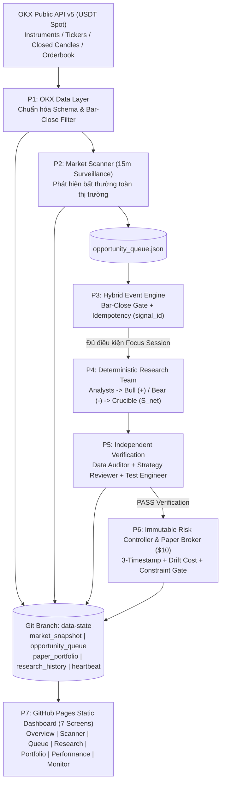

# KẾ HOẠCH TỔNG THỂ: VIBETRADE v1.1
## Personal Autonomous Crypto Intelligence System ($0 Budget Edition)

> **Tầm nhìn kiến trúc:** Cải tạo phẫu thuật (*Surgical Refactor*) từ `HKUDS/Vibe-Trading` thành một hệ thống tình báo và giao dịch mô phỏng tiền mã hóa tự hành cá nhân với **ngân sách vận hành $0 tuyệt đối** — sử dụng **OKX Public API (USDT Spot)**, tính toán định lượng giải thích được (**Deterministic Weighted Scoring Engine** thay thế hoàn toàn LLM trả phí), vận hành định kỳ trên **GitHub Actions**, lưu trữ trạng thái nguyên tử trên nhánh **`data-state`**, và hiển thị trực quan qua **7 màn hình tĩnh trên GitHub Pages**.

---

## 1. Các Nguyên Tắc Bất Biến Xuyên Suốt Dự Án

| Trục Kiểm Soát | Quy Tắc Bất Biến | Skill Giám Sát |
| :--- | :--- | :--- |
| **Ngân sách ($0)** | Không gọi bất kỳ API LLM trả phí hay nguồn dữ liệu thương mại nào; tận dụng hạ tầng miễn phí của OKX Public API, GitHub Actions và GitHub Pages. | `security`, `code-review-and-quality` |
| **Kế thừa Mã nguồn** | Cấm đập đi xây lại (*No Full Rewrite*); phân loại rõ `KEEP` / `ADAPT` / `REPLACE` / `REMOVE` trước khi can thiệp. | `codebase-surgical-auditor` |
| **Toàn vẹn Dữ liệu** | Ưu tiên `*-USDT` Spot; bắt buộc **Bar-Close Confirmation** (`candle_close_time <= current_time`); cấm Lookahead Bias; định danh lũy đẳng `symbol:timeframe:candle_timestamp`. | `quant-data-guard` |
| **Định lượng Giải thích được** | Không giả vờ làm LLM; chấm điểm trọng số `Bull` / `Bear` / `Crucible` + `Market Regime Multiplier` kèm **Evidence Binding**; thiếu dữ liệu trả về `INCONCLUSIVE`. | `deterministic-personas-engine` |
| **Bất khả xâm phạm Rủi ro** | AI/Research không được sửa `Risk Controller`; tách 3 mốc thời gian + tính `schedule_drift_cost`; vốn ảo `$10.0`, phí `0.1%`/chiều, kiểm tra `minSz`/thanh khoản -> `REJECTED_BY_CONSTRAINT`; tách rõ `realized_pnl` và `unrealized_pnl`. | `immutable-risk-test-gate` |
| **Lưu trữ Bền vững** | Tách nhánh `main` (code/UI/tests) và `data-state` (5 JSON snapshots); khóa `concurrency`; ghi `.tmp` + xác thực schema + `os.replace()`; giới hạn xoay vòng log. | `atomic-state-persistence` |

---

## 2. Sơ Đồ Kiến Trúc Luồng Dữ Liệu Đích (VibeTrade v1.1)

---

## 3. Lộ Trình Triển Khai Chi Tiết (P0 → P8)

### Phase P0 — Repository Audit (Chế độ Read-Only)
- **Mục tiêu:** Giải phẫu toàn bộ mã nguồn `HKUDS/Vibe-Trading` hiện có mà **không sửa đổi bất kỳ dòng code gốc nào**, xác định chính xác phần lõi định lượng tái sử dụng được và các điểm nghẽn chi phí/kiến trúc.
- **Hạng mục thực thi:**
  1. Lập bản đồ kiến trúc và luồng dữ liệu hiện hữu của `Vibe-Trading`.
  2. Kiểm toán 5 khía cạnh: (a) Phụ thuộc LLM & nguồn dữ liệu cũ, (b) Persistence/State, (c) Scheduling/Loop, (d) Paper Trading, PnL & Risk, (e) Frontend & kết nối Backend.
  3. Phân loại chi tiết từng module/file vào 4 nhãn: `KEEP` / `ADAPT` / `REPLACE` / `REMOVE` có trích dẫn file và hàm/class cụ thể.
  4. Thiết lập bản thiết kế cầu nối chuẩn bị cho Phase P1.
- **Sản phẩm bàn giao:** `P0_AUDIT_REPORT.md` (xác nhận `git diff` trên file gốc = 0).
- **Skills chủ đạo:** `codebase-surgical-auditor`, `security`.

---

### Phase P1 — OKX Data Layer (Public API & Chuẩn Hóa Dữ Liệu)
- **Mục tiêu:** Xây dựng tầng thu thập và chuẩn hóa dữ liệu thị trường giao ngay `*-USDT` từ OKX Public REST API v5 với chi phí `$0`, không cần API key.
- **Hạng mục thực thi:**
  1. Triển khai client HTTP bền bỉ (timeout, retry/backoff cho `429`/`5xx`, kiểm tra chứng chỉ TLS) cho 4 nhóm dữ liệu:
     - `instruments` (`instType=SPOT`): lấy `tickSz`, `lotSz`, `minSz`, trạng thái giao dịch `live`.
     - `tickers` (`instType=SPOT`): lấy giá khớp gần nhất, `bidPx`/`askPx`, khối lượng 24h (`vol24h`, `volCcy24h`).
     - `candles` / `history-candles`: chuẩn hóa OHLCV đa khung (`15m`, `1H`, `4H`, `1D`), **tự động loại bỏ mọi cây nến chưa đóng** (`confirm == "0"` hoặc `candle_close_time > current_time`).
     - `books`: đo `spread_bps`, độ sâu thanh khoản hai đầu (`bid_depth_usd`, `ask_depth_usd`) và trượt giá ước tính.
  2. Chuẩn hóa đầu ra về Pydantic/dataclass bất biến và tạo snapshot `market_snapshot.json`.
- **Cổng kiểm thử (Test Gate P1):** Unit tests (mock HTTP responses, lọc nến chưa đóng, xử lý lỗi mạng/JSON hỏng, kiểm tra quy tắc làm tròn `lotSz`/`tickSz`) + Truncation Invariance cơ bản.
- **Skills chủ đạo:** `quant-data-guard`, `python-dev`, `security`.

---

### Phase P2 — Market Scanner (Surveillance Mode 15 Phút)
- **Mục tiêu:** Quét nhẹ toàn bộ vũ trụ cặp `*-USDT` Spot định kỳ mỗi 15 phút để lọc thanh khoản rác và phát hiện các bất thường định lượng đáng chú ý đưa vào hàng đợi cơ hội.
- **Hạng mục thực thi:**
  1. Thiết lập bộ lọc vũ trụ khả giao dịch (*Tradable Universe Filter*): loại bỏ stablecoin pairs, cặp thanh khoản 24h thấp hoặc `spread_bps` quá giãn không phù hợp với danh mục `$10.0`.
  2. Tính toán bộ chỉ số quét nhanh ở **Surveillance Mode** trên nến đã đóng: đột biến khối lượng (`RVOL` / `Volume Z-Score`), bứt phá biên độ giá (`Breakout` / `ATR expansion`), thay đổi cấu trúc động lượng ngắn hạn và đánh giá `Market Regime` toàn thị trường (dựa trên `BTC-USDT` + độ rộng thị trường).
  3. Xếp hạng mức độ ưu tiên và cập nhật vào cấu trúc `opportunity_queue.json`.
- **Cổng kiểm thử (Test Gate P2):** Unit tests bộ lọc thanh khoản, phát hiện bất thường tất định, kiểm tra không rò rỉ dữ liệu tương lai (`Anti-Lookahead`) + Regression P1.
- **Skills chủ đạo:** `quant-data-guard`, `python-dev`.

---

### Phase P3 — Hybrid Event Engine (Bar-Close & Focus Session Trigger)
- **Mục tiêu:** Đóng vai trò bộ điều phối sự kiện lai (*Surveillance Routine 15m* kết hợp *Event-driven Focus Session*), đảm bảo chống nhiễu, chống lặp và tiết kiệm tài nguyên tính toán.
- **Hạng mục thực thi:**
  1. Kiểm tra kép **Bar-Close Confirmation** trước khi thăng cấp bất kỳ ứng viên nào trong `opportunity_queue.json`.
  2. Sinh khóa định danh bất biến `signal_id = symbol + timeframe + candle_timestamp` và đối chiếu với sổ cái chống trùng lặp (*Idempotency Registry*) để một cây nến không bao giờ kích hoạt xử lý hai lần.
  3. Chỉ kích hoạt **Focus Session** (nạp sâu sổ lệnh + đa khung thời gian cho Research Team P4) đối với top ứng viên vượt ngưỡng điểm kích hoạt và thỏa điều kiện thanh khoản sơ bộ; quản lý vòng đời trạng thái cơ hội (`PENDING` -> `IN_FOCUS` -> `EVALUATED` / `EXPIRED`).
- **Cổng kiểm thử (Test Gate P3):** Unit tests kiểm chứng lũy đẳng (quét lặp lại nến cũ = 0 sự kiện mới), chuyển trạng thái hàng đợi, hết hạn tín hiệu cũ + Regression P1–P2.
- **Skills chủ đạo:** `quant-data-guard`, `python-dev`.

---

### Phase P4 — Research Team (Weighted Scoring Engine & Evidence Templates)
- **Mục tiêu:** Thay thế hoàn toàn các lời gọi LLM tốn phí bằng đội ngũ phân tích định lượng đa góc nhìn có khả năng giải thích tường minh (**Explainable Quantitative System**).
- **Hạng mục thực thi:**
  1. **`Analysts`:** Trích xuất bộ chỉ số chuẩn hóa (Trend/Momentum, Volume/Volatility, Microstructure/Liquidity) trên dữ liệu đã khóa mốc thời gian đóng nến.
  2. **`Bull Researcher`:** Chấm điểm cộng $S_{\text{Bull}} \in [0, 100]$ từ các bằng chứng định lượng tích cực có trọng số cố định.
  3. **`Bear Researcher`:** Chấm điểm rủi ro/phản biện $S_{\text{Bear}} \in [0, 100]$ từ các bằng chứng bất lợi (kháng cự gần, quá mua, thanh khoản mỏng, spread giãn, biến động gắt).
  4. **`Crucible`:** Tổng hợp $S_{\text{net}} = (S_{\text{Bull}} - S_{\text{Bear}}) \times M_{\text{regime}}$ với bảng hệ số `Market Regime Multiplier` tường minh và xuất nhận định qua **Evidence-based Templates**.
  5. **Ràng buộc Bằng chứng & `INCONCLUSIVE`:** Mọi điểm cộng/trừ phải đính kèm `{rule_id, metric, value, threshold, timestamp}`; bất kỳ thiếu hụt dữ liệu đầu vào nào lập tức trả về `INCONCLUSIVE`.
- **Cổng kiểm thử (Test Gate P4):** Unit tests kiểm tra tính tất định 100%, kiểm tra tổng trọng số, kiểm tra thiếu dữ liệu trả về `INCONCLUSIVE`, kiểm tra bằng chứng đính kèm đầy đủ + Regression P1–P3.
- **Skills chủ đạo:** `deterministic-personas-engine`, `python-dev`.

---

### Phase P5 — Independent Verification (Cổng Kiểm Định Độc Lập)
- **Mục tiêu:** Thiết lập chốt chặn kiểm toán độc lập giữa Research Team (P4) và Risk Controller (P6) nhằm triệt tiêu lỗi dữ liệu bẩn hoặc sai lệch công thức tính điểm.
- **Hạng mục thực thi:**
  1. **`Data Auditor`:** Kiểm tra độc lập độ tươi, tính liên tục thời gian, xác nhận đóng nến và sự vắng mặt của `NaN`/`Inf` trên gói dữ liệu đầu vào của Focus Session.
  2. **`Strategy Reviewer`:** Tính lại độc lập $S_{\text{Bull}}$, $S_{\text{Bear}}$, $M_{\text{regime}}$, $S_{\text{net}}$ từ danh sách bằng chứng thô; xác nhận mọi kết luận đều gắn với `rule_id` hợp lệ.
  3. **`Test Engineer` (Runtime Contract Gate):** Xác thực schema đầu ra của biên bản nghiên cứu trước khi ghi vào `research_history.json` và chỉ cho phép tín hiệu đạt chuẩn đi tiếp sang P6.
- **Cổng kiểm thử (Test Gate P5):** Unit tests cố tình tiêm dữ liệu lỗi / làm sai lệch tổng điểm để xác nhận cổng kiểm định phát hiện và chặn 100% + Regression P1–P4.
- **Skills chủ đạo:** `deterministic-personas-engine`, `code-review-and-quality`.

---

### Phase P6 — Risk Controller & Paper Trading ($10 Virtual Portfolio)
- **Mục tiêu:** Quản trị rủi ro bất khả xâm phạm và mô phỏng khớp lệnh trung thực tuyệt đối cho danh mục vốn nhỏ `$10.0` dưới điều kiện thực tế của sàn OKX và độ trễ lập lịch đám mây.
- **Hạng mục thực thi:**
  1. **`Immutable Risk Controller`:** Cấu hình đóng băng (`frozen` + kiểm tra hash SHA-256) hoàn toàn tách biệt khỏi quyền ghi của AI/Research Engine; kiểm soát tỷ trọng vị thế tối đa, số vị thế đồng thời, ngưỡng sụt giảm vốn (`max_drawdown`) và giới hạn spread/thanh khoản.
  2. **Toàn vẹn 3 Mốc Thời gian & Khớp lệnh:**
     - Lưu rõ `candle_close_time`, `signal_timestamp`, `execution_timestamp`.
     - *Backtest:* Khớp tại `Open` của nến kế tiếp cộng spread/slippage và phí.
     - *Live Paper Trading:* Khớp theo giá/sổ lệnh thực tế của OKX ngay tại `execution_timestamp` (tuyệt đối không lấy lại giá quá khứ lúc đóng nến) và tính tường minh `schedule_drift_cost`.
  3. **Cấu hình Chi phí & Ràng buộc Sàn (`REJECTED_BY_CONSTRAINT`):**
     - Cấu hình hóa: `initial_balance: 10.0`, `fee_rate: 0.001` mỗi chiều, `slippage_model: spread_plus_latency`, `minimum_order_check: true`.
     - Kiểm tra `minSz`, `lotSz`, `tickSz` của cặp Spot trên OKX và số dư sau phí; nếu không đạt thì ghi log trạng thái `REJECTED_BY_CONSTRAINT` kèm lý do chi tiết.
  4. **Kế toán PnL & Ghi Trạng thái Nguyên tử:** Tách biệt hoàn toàn `realized_pnl` và `unrealized_pnl`; lưu `paper_portfolio.json` bằng giao thức `.tmp` + xác thực schema + `os.replace()`.
- **Cổng kiểm thử (Test Gate P6):** Unit tests cho toàn bộ công thức phí/slippage/`schedule_drift_cost`, kiểm tra `REJECTED_BY_CONSTRAINT` với tài khoản `$10.0`, kiểm tra bất biến sửa đổi Risk Controller, kiểm tra ghi nguyên tử khi lỗi giữa chừng + Regression P1–P5.
- **Skills chủ đạo:** `immutable-risk-test-gate`, `atomic-state-persistence`, `python-dev`.

---

### Phase P7 — Dashboard 7 Màn Hình & Hạ Tầng Đám Mây ($0 GitHub Actions & Pages)
- **Mục tiêu:** Triển khai vận hành tự động không máy chủ (*Serverless Autonomous Ops*) với kiến trúc tách 2 nhánh Git (`main` / `data-state`) và giao diện giám sát trực quan 7 màn hình trên GitHub Pages.
- **Hạng mục thực thi:**
  1. **Tách nhánh & Chuẩn hóa 5 Snapshot trên `data-state`:**
     `market_snapshot.json`, `opportunity_queue.json`, `paper_portfolio.json`, `research_history.json`, `heartbeat.json` kèm cơ chế FIFO log rotation.
  2. **GitHub Actions Workflows:**
     - Workflow quét định kỳ 15 phút (`cron: '*/15 * * * *'` + `workflow_dispatch`) có khóa `concurrency`, ghi file nguyên tử và **Smart Commit** chỉ khi trạng thái thực sự thay đổi.
     - Workflow kiểm thử CI (`pytest` + `vitest` + `vite build`) và tự động deploy tĩnh lên **GitHub Pages**.
  3. **Dashboard 7 Màn Hình Tĩnh (`frontend/`):**
     - `1. Overview`: Tổng quan vốn `$10.0`, PnL thực/tạm tính, Regime thị trường, nhịp đập hệ thống.
     - `2. Market Scanner`: Bảng giám sát toàn thị trường `*-USDT` Spot và cờ bất thường.
     - `3. Opportunity Queue`: Hàng đợi tín hiệu, trạng thái vòng đời và khóa `signal_id`.
     - `4. AI Research Room`: Điểm số `Bull`/`Bear`/`Crucible`, bảng bằng chứng định lượng, kiểm định độc lập và trạng thái `INCONCLUSIVE`.
     - `5. Paper Portfolio`: Vị thế mở, tiền mặt, lịch sử giao dịch, chi phí ma sát, `schedule_drift_cost` và danh sách `REJECTED_BY_CONSTRAINT`.
     - `6. Performance`: Đường cong vốn ròng sau chi phí, thống kê hiệu suất, phân rã chi phí và so sánh với baseline.
     - `7. System Monitor`: Sức khỏe `heartbeat.json`, độ trễ lịch GitHub Actions, dung lượng/số bản ghi các snapshot trên `data-state`.
- **Cổng kiểm thử (Test Gate P7):** Vitest 4-state UI tests cho cả 7 màn hình, kiểm tra build tĩnh GitHub Pages, kiểm tra workflow YAML & atomic persistence end-to-end + Regression P1–P6.
- **Skills chủ đạo:** `atomic-state-persistence`, `frontend-design`, `webapp-testing`, `security`, `code-review-and-quality`.

---

### Phase P8 — 7-Day Live Autonomous Experiment & Post-Cost Evaluation
- **Mục tiêu:** Vận hành thực chiến liên tục 7 ngày trên GitHub Actions & GitHub Pages với vốn mô phỏng `$10.0`, đo lường trung thực hiệu quả định lượng sau toàn bộ chi phí thực tế.
- **Hạng mục thực thi:**
  1. Khởi chạy danh mục chuẩn `$10.00 USDT` trên nhánh `data-state` và theo dõi tự hành xuyên suốt 7 ngày (`~672` chu kỳ quét 15 phút) không can thiệp sửa tay thông số rủi ro.
  2. Thu thập số liệu vận hành thực tế: độ trễ lập lịch GitHub Actions (`schedule_drift_ms`, `schedule_drift_cost`), tỷ lệ tín hiệu `INCONCLUSIVE`, tỷ lệ lệnh vướng rào cản vốn nhỏ `REJECTED_BY_CONSTRAINT`, độ ổn định của `heartbeat.json` và dung lượng nhánh `data-state`.
  3. Xuất báo cáo tổng kết thực nghiệm đánh giá lợi nhuận ròng sau phí & trượt giá (*Post-Cost Net Return*, *Max Drawdown*, *Sharpe/Profit Factor*) đối chiếu trực tiếp với 2 đường chuẩn (*Baselines*):
     - **Baseline 1:** Giữ nguyên tiền mặt (`100% USDT Cash = $10.00`).
     - **Baseline 2:** Mua và nắm giữ `BTC-USDT` (*Buy & Hold* với cùng mức vốn `$10.00` và cùng biểu phí `0.1%`).
- **Sản phẩm bàn giao:** Báo cáo đánh giá thực nghiệm 7 ngày (`P8_EXPERIMENT_REPORT.md`) + đề xuất tinh chỉnh tham số cho phiên bản tiếp theo.
- **Skills chủ đạo:** `immutable-risk-test-gate`, `code-review-and-quality`.
